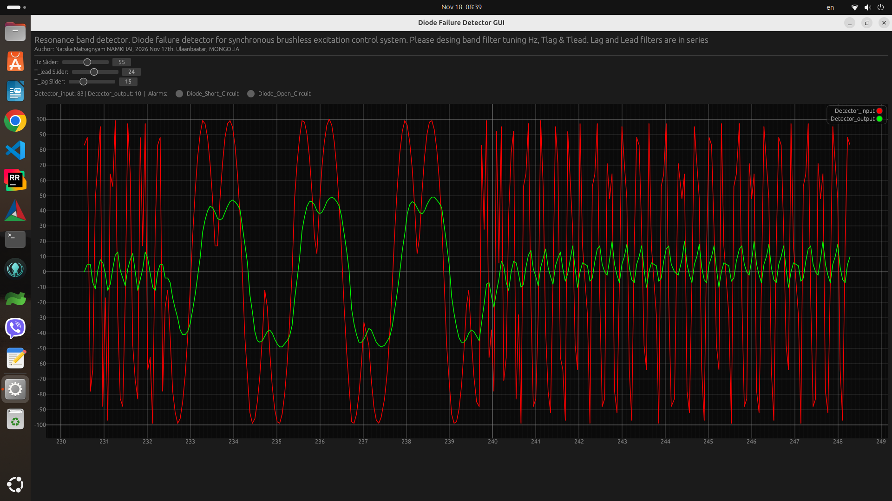
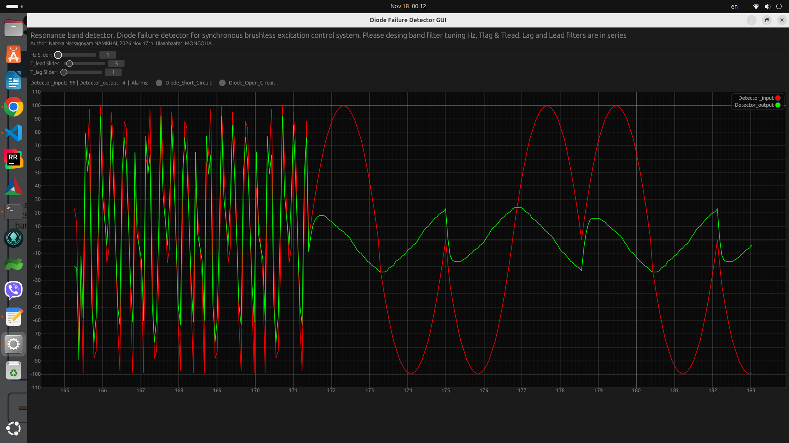
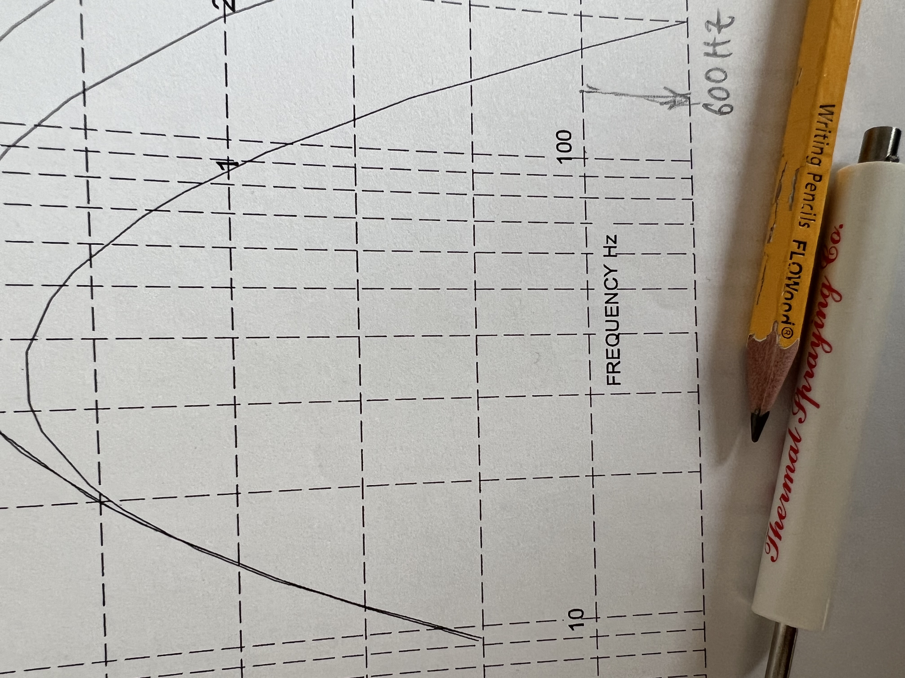
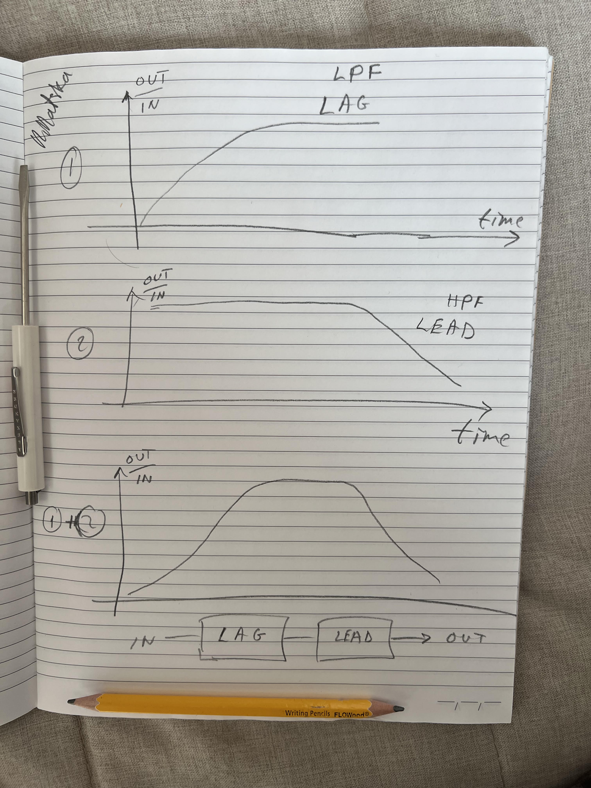

# Diode Failure Detector for Synchronous Brushless Excitation Systems

**Author:** Natska Natsagnyam NAMKHAI  
**Version:** 5.1.0  
**License:** GPL-2+  

---
It requires hard working to find desired tuning


## Overview

The **Diode Failure Detector** is an integrated Linux kernel module (`simple_telemetry`) and high-performance Rust eGUI visualization application. It provides real-time monitoring, phase approximation filtering, and anomaly/alarm detection (short and open circuit conditions) for synchronous brushless alternator excitation control systems.
However, it is useful tool to learn resonance circuit tuning. Output = input * lag(T_lag) * lead(T_lad); Please deign own Hz resonance by tuning. E.g: select Hz you want to see resonance. Tune T_lag & T_lead. 
Characteristic: 
Larger T_lag & Lower T_lead will blocking band in the middle point of Hz slider.
Larger T_lead & Lower T_lag will unblocking band in the middle point of Hz slider.

Please keep hard working to find desired tuning. Better version available on request commercially.


Circuit characteristic: frequency_response


Circuit philosophy: frequency_response_theory


---

## System Architecture

* **Kernel Space (`simple_telemetry.ko`):** Operates via synchronous ProcFS virtual endpoints (`/proc/simple-telemetry/`). It calculates integer sine wave approximations ($A = 100$), applies digital lead/lag filters and bridge-rectifier smoothing, and evaluates diode failure states.
* **User Space (`diode-failure-detector`):** A maximized Rust eGUI telemetry interface built on `eframe` and `egui_plot`. It polls the kernel stream every 50ms to render real-time dual-trace line plots and live alarm LED indicators (`Diode_Short_Circuit`, `Diode_Open_Circuit`).

---

## ProcFS Endpoints

| Endpoint Path | Access | Description |
| :--- | :--- | :--- |
| `/proc/simple-telemetry/stream` | Read-Only | Streams CSV snapshot: `timestamp_ms,din,dout,short_alarm,open_alarm` |
| `/proc/simple-telemetry/hz` | Read/Write | Controls waveform frequency step (`1` to `100`) |
| `/proc/simple-telemetry/t_lead` | Read/Write | Adjusts time constant lead (`>= 1`) |
| `/proc/simple-telemetry/t_lag` | Read/Write | Adjusts time constant lag (`>= 1`) |

---

## Installation & Deployment (DKMS)

This package supports **DKMS (Dynamic Kernel Module Support)**, ensuring the kernel module automatically recompiles in the background during system kernel updates.

### 1. Build the Debian Package
Ensure you have build tools and kernel headers installed, then build the package:
```bash
make clean && make
cd eGUI && cargo build --release && cd ..
dpkg-deb --build debian-pkg diode-failure-detector_5.1.0_amd64.deb
2. Install via Dpkg
Bash
sudo dpkg -i diode-failure-detector_5.1.0_amd64.deb
3. Verify DKMS Status
Bash
dkms status
Usage
Load Module (if not auto-loaded on boot via /etc/modules):

Bash
sudo modprobe simple_telemetry
Launch eGUI Telemetry Dashboard:

Via terminal: diode-failure-detector

Via Ubuntu Application Menu: Search for "Diode Failure Detector"

Documentation
A complete engineering manual complete with schematics and frequency response theory is available post-installation at:/usr/share/doc/diode-failure-detector/Technical_Manual_Diode_Detector.pdf
