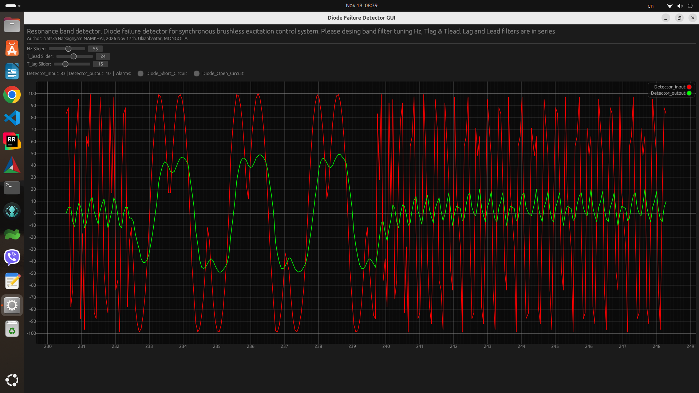
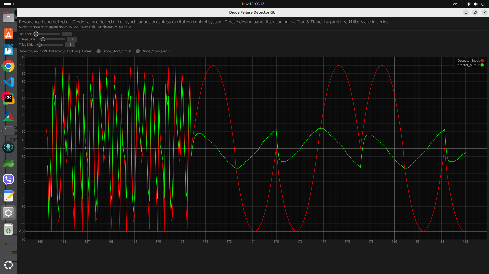
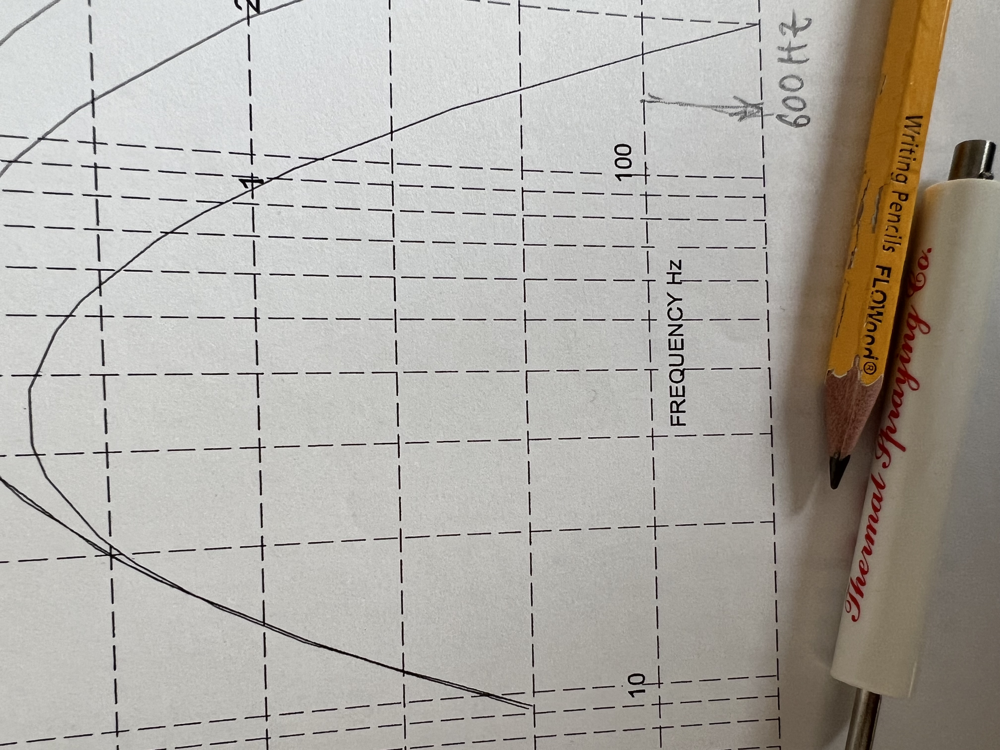
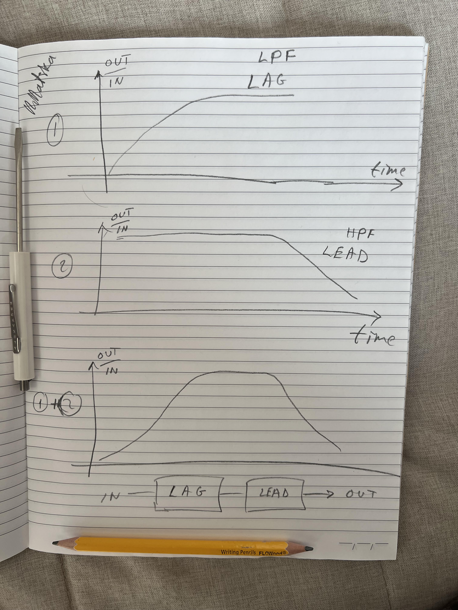

# Technical Manual: Diode Failure Detector for Synchronous Brushless Excitation Systems
**Author:** Natska Natsagnyam NAMKHAI  
**Version:** 5.1.0  
**Date:** November 2026  

---
It requires hard working to find desired tuning

## 1. Overview
The **Diode Failure Detector** is an integrated Linux kernel module (`simple_telemetry`) and high-performance Rust eGUI visualization application designed for real-time monitoring and anomaly detection in synchronous brushless alternator excitation control systems.
However, it is useful tool to learn resonance circuit tuning. Output = input * lag(T_lag) * lead(T_lad); Please deign own Hz resonance by tuning. E.g: select Hz you want to see resonance. Tune T_lag & T_lead. 
Characteristic: 
Larger T_lag & Lower T_lead will blocking band in the middle point of Hz slider.
Larger T_lead & Lower T_lag will unblocking band in the middle point of Hz slider.

Please keep hard working to find desired tuning. Better version available on request commercially.

Circuit characteristic: frequency_response

Circuit philosophy: frequency_response_theory

## 2. System Architecture
* **Kernel Space (`simple_telemetry.ko`):** Operates via synchronous ProcFS endpoints (`/proc/simple-telemetry/`). It computes real-time integer sine wave approximations, applies digital lag/lead filters and bridge-rectifier smoothing, and evaluates diode short/open circuit alarm states.
* **User Space (`diode-failure-detector`):** A maximized Rust eGUI telemetry interface that polls the kernel stream every 50ms, rendering real-time dual-trace line plots and alarm LEDs (`Diode_Short_Circuit`, `Diode_Open_Circuit`).

## 3. ProcFS Endpoints
| Path | Access | Description |
| :--- | :--- | :--- |
| `/proc/simple-telemetry/stream` | Read-Only | Streams CSV snapshot: `timestamp_ms,din,dout,short_alarm,open_alarm` |
| `/proc/simple-telemetry/hz` | Read/Write | Controls waveform frequency step (`1` to `20`) |
| `/proc/simple-telemetry/t_lead` | Read/Write | Adjusts lead time constant (`>= 1`) |
| `/proc/simple-telemetry/t_lag` | Read/Write | Adjusts lag time constant (`>= 1`) |

## 4. Operational Guidelines & Installation
1. **Install Package:** `sudo dpkg -i diode-failure-detector_5.1.0_amd64.deb`
2. **Load Module:** `sudo modprobe simple_telemetry`
3. **Launch GUI:** Open **Diode Failure Detector** from your Ubuntu application menu or type `diode-failure-detector` in the terminal.
